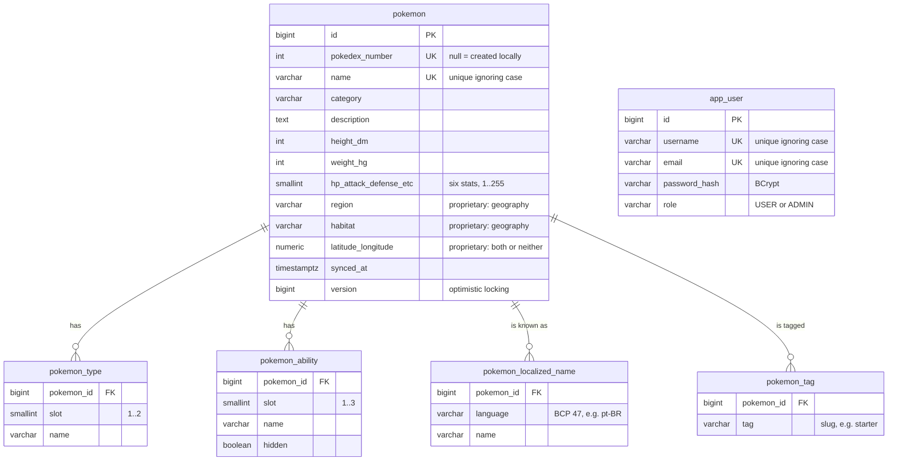

# Poke

A Pokémon management API built with **Java 27 + Spring Boot 4**, using Uncle Bob's **Clean Architecture** and **TDD**.
It reads from [PokeAPI](https://pokeapi.co/docs/v2), caches what it reads, and keeps a local **PostgreSQL** store for
proprietary data. This is the Ballast Lane Java technical assessment (spec: [`tech.pdf`](tech.pdf), transcribed in
[`docs/assessment-spec.md`](docs/assessment-spec.md)).

| Story | Status | Endpoint |
|---|---|---|
| US01: Pokémon enumeration (paginated: sprite, category, mass, abilities) | ✅ | `GET /api/v1/pokemon?page&size` |
| US02: Detailed view (image, base stats, description, evolution chain) | ✅ | `GET /api/v1/pokemon/{id}` |
| US03: Data synchronization to the local database | ⏳ schema ready | — |
| US04: Local updates with validation | ⏳ | — |
| Users, authentication, frontend | ⏳ | — |

## Quick start

The only requirement is **Docker** (with Compose v2).

```bash
git clone https://github.com/cunhazera/poke.git && cd poke
docker compose up --build          # app + PostgreSQL; Flyway migrates the database on startup
curl http://localhost:8080/api/v1/pokemon/133
```

The app listens on `http://localhost:8080`. Stop it with `Ctrl+C`, or with `docker compose down`. Add `--volumes` to also wipe the database.

## Running the tests

Everything runs in containers, so no local JDK or Node is needed:

| What | Command | Notes |
|---|---|---|
| Unit, integration and architecture tests | `docker compose run --rm test` | Runs `./gradlew build` on JDK 27. Integration tests start their own PostgreSQL 18 through Testcontainers, using the mounted Docker socket. |
| Black-box API tests (Newman) | `docker compose up -d --build`<br>`docker compose run --rm api-tests` | Runs the Postman collections in [`api-tests/`](api-tests/README.md) against the running app and the **live** PokeAPI |

CI ([`.github/workflows/ci.yml`](.github/workflows/ci.yml)) runs the build and tests on every push and pull request. It
also builds the Docker image and smoke-tests the compose stack.

**Test layers:**
- **Domain and use-case unit tests:** plain JUnit, with an in-memory fake catalog. Nothing is mocked that the code under test doesn't actually call.
- **Adapter tests:** the real HTTP client runs against a fake PokeAPI server that serves trimmed real payloads.
- **`SchemaMigrationTest`:** runs the real Flyway migrations on PostgreSQL 18 and proves every constraint with an `INSERT`.
- **Web-slice tests:** pin the exact JSON contract and every error.
- **End-to-end tests:** start the full Spring context, including the cache.
- **ArchUnit:** enforces the dependency rule.
- **Newman collections:** run against the real server.

## API

All errors use [RFC 9457](https://www.rfc-editor.org/rfc/rfc9457) `application/problem+json`, with the same shape
everywhere. They never include stack traces or internal hosts.

### `GET /api/v1/pokemon?page=0&size=20` (US01)
A page of Pokémon in Pokédex order. There is one entry per species (1025), and alternate forms are excluded.
`size` is 1–50 and `page` is zero-based.

```json
{
  "items": [
    { "id": 1, "name": "bulbasaur", "spriteUrl": "https://…/1.png", "category": "Seed Pokémon", "weightKg": 6.9,
      "abilities": [ { "name": "overgrow", "hidden": false }, { "name": "chlorophyll", "hidden": true } ] }
  ],
  "page": 0, "size": 20, "totalItems": 1025, "totalPages": 52, "hasNext": true, "hasPrevious": false
}
```

### `GET /api/v1/pokemon/{id}` (US02)
`id` is the national Pokédex number. `evolutionChain` is a **tree** that starts at the chain's first stage, since chains can
branch (Eevee has 8 evolutions). `description` is the latest English Pokédex entry.

```json
{
  "id": 133, "name": "eevee", "category": "Evolution Pokémon",
  "imageUrl": "https://…/official-artwork/133.png", "spriteUrl": "https://…/133.png",
  "description": "Harbors the potential to evolve into manifold forms. …",
  "heightM": 0.3, "weightKg": 6.5, "types": ["normal"],
  "abilities": [ { "name": "run-away", "hidden": false }, { "name": "adaptability", "hidden": false },
                 { "name": "anticipation", "hidden": true } ],
  "stats": { "hp": 55, "attack": 55, "defense": 50, "specialAttack": 45, "specialDefense": 65, "speed": 55, "total": 325 },
  "evolutionChain": { "id": 133, "name": "eevee", "spriteUrl": "https://…/133.png", "evolvesTo": [
    { "id": 134, "name": "vaporeon", "spriteUrl": "https://…/134.png", "evolvesTo": [] }, "…"
  ] }
}
```

| Status | When |
|---|---|
| 400 | `page`/`size` out of range, malformed or repeated; `id` not a positive integer (`0`, `abc`, `1.5`, `+1`, overflow) |
| 404 | No species has that number (`/pokemon/1026`), or the number belongs to an alternate form (`/pokemon/10001`) |
| 503 | PokeAPI is down, slow (5 s read timeout) or returned invalid data |
| 500 | Anything unexpected (generic message; details only in the logs) |

**Caching:** PokeAPI responses are cached for 24 h with Caffeine, one cache per upstream resource. The listing and
the detail view share entries. A warm detail view takes about 4 ms. Cold, Eevee took about 2 s, because its chain has 9 stages. Failures are never cached.

## Architecture

Dependencies point **inward only**. The domain and the use cases contain no framework code, and
[`CleanArchitectureTest`](src/test/java/com/app/poke/architecture/CleanArchitectureTest.java) (ArchUnit) fails the build if that changes.

```
com.app.poke
├── domain/          Entities: immutable records with their invariants (PokemonDetail, BaseStats, EvolutionStage…)
├── application/     Use cases
│   ├── port/in/     input boundaries:  ListPokemonUseCase, GetPokemonDetailUseCase (+ Query records)
│   ├── port/out/    output boundaries: PokemonCatalogGateway
│   └── usecase/     interactors (no Spring annotations), e.g. GetPokemonDetailInteractor
├── adapter/
│   ├── in/web/      REST controller, DTOs, mappers, GlobalExceptionHandler (ProblemDetail)
│   └── out/pokeapi/ RestClient gateway + PokeAPI DTOs (cached)
└── config/          composition root: @Bean wiring, properties
```

The interactors run the upstream fan-out concurrently on virtual threads. For a detail view, the profile and species
are fetched in parallel, then the evolution chain, then every other stage's sprite in parallel.
The placement rules for new code are in [`.claude/skills/clean-architecture/SKILL.md`](.claude/skills/clean-architecture/SKILL.md).

## Database

PostgreSQL 18. The schema is owned by **Flyway** ([`src/main/resources/db/migration`](src/main/resources/db/migration)),
and an applied migration is never edited: every change gets a new `V<n>__…sql`. The tables already exist. The code that
uses them arrives with US03 (sync), US04 (updates) and authentication.



## Configuration

Every setting has a working default. To override one, copy [`.env.example`](.env.example) to `.env` (Compose reads it), or set the
variable in the environment.

| Variable | Default | Purpose |
|---|---|---|
| `DB_NAME` / `DB_USER` / `DB_PASSWORD` | `poke` / `poke` / `poke` | PostgreSQL credentials (demo values) |
| `DB_URL` | `jdbc:postgresql://localhost:5432/poke` | JDBC URL used by the app (compose points it at the `postgres` service) |
| `DB_PORT` / `APP_PORT` | `5432` / `8080` | Host ports published by compose |
| `POKEAPI_BASE_URL` | `https://pokeapi.co/api/v2` | Upstream catalog |

## Project docs
- [`HANDOFF.md`](HANDOFF.md): the current state and how to resume work
- [`WORK_TRACKER.md`](WORK_TRACKER.md): progress, the decision log (D1…), scope, and how AI tooling was used and corrected
- [`docs/plans/`](docs/plans): per-story implementation plans
- [`api-tests/README.md`](api-tests/README.md): the black-box test collections

## Appendix: running without Docker
You need JDK 27 and a PostgreSQL 18 on `localhost:5432` (for example `docker compose up -d postgres`). Docker must also be running for the
Testcontainers-based tests.

```bash
./gradlew bootRun     # the app
./gradlew build       # all tests
```
