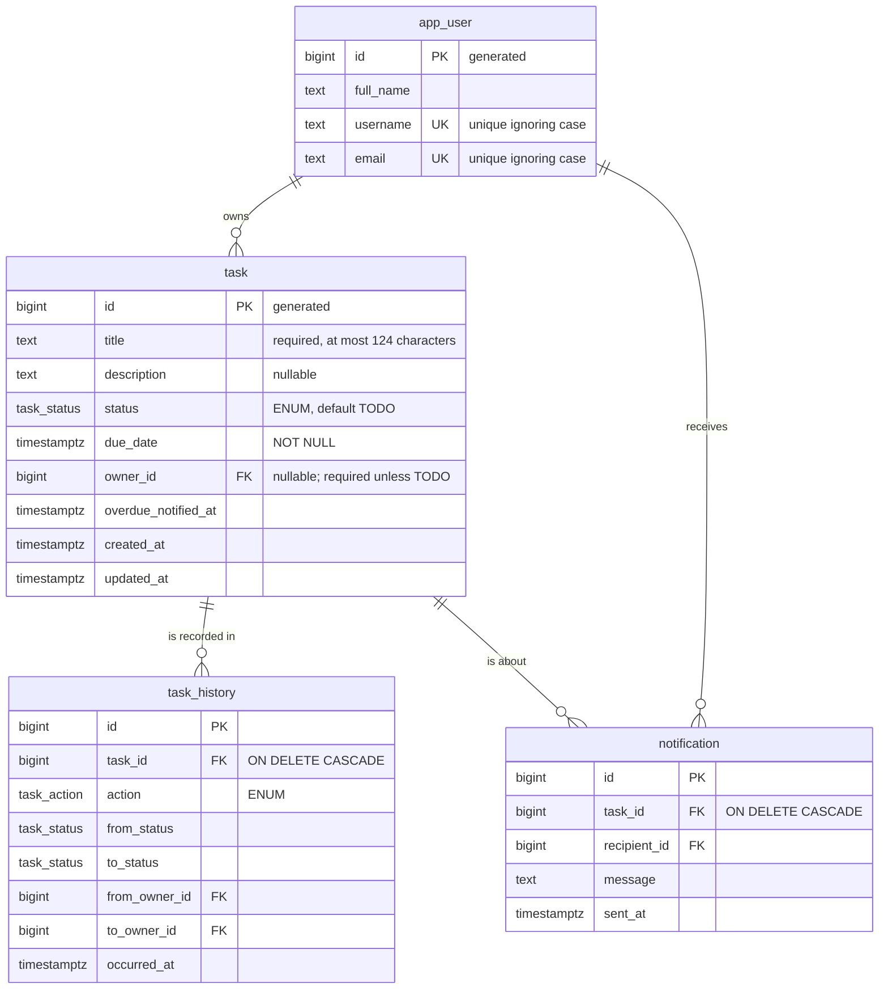

# Task API

A task-management REST API: tasks with a title, description, status, due date and owner, moved across a
**To do → In progress → Done** board, with a full history of every change and (mock) notifications when a task
passes its due date.

**Java 25 · Spring Boot 4.1 · Gradle 9 · PostgreSQL 18 · Flyway · Testcontainers.**

> A standalone sample (the assessment's generative-AI exercise), separate from the Pokémon application in the parent
> folder: its own build, database and containers.

## Run it

The only requirement is **Docker** (with Compose v2). There is nothing to configure.

```bash
cd task-api
docker compose up --build
```

- The API listens on **http://localhost:8081**. It is ready when the log says `Started TaskApiApplication`, or when `docker compose up --wait` returns.
- PostgreSQL starts with it. Flyway creates the schema and the **five default users** on the first start.
- Stop with `Ctrl+C`, or with `docker compose down`. Add `--volumes` to also delete the data.
- **Port taken?** Run `TASKS_PORT=9090 docker compose up --build` instead.

### Try it
```bash
# The default users (the board admin is ada)
curl -s localhost:8081/api/users

# Create a task: it starts in TODO, without an owner. dueDate is an ISO-8601 date-time with an offset.
curl -s -X POST localhost:8081/api/tasks -H 'Content-Type: application/json' \
  -d '{"title":"Prepare the demo","description":"Slides and a live API","dueDate":"2030-01-15T18:00:00-03:00"}'

# Assign it to grace (user 3), start it, finish it
curl -s -X PUT localhost:8081/api/tasks/1/owner  -H 'Content-Type: application/json' -d '{"userId":3}'
curl -s -X PUT localhost:8081/api/tasks/1/status -H 'Content-Type: application/json' -d '{"status":"IN_PROGRESS"}'
curl -s -X PUT localhost:8081/api/tasks/1/status -H 'Content-Type: application/json' -d '{"status":"DONE"}'

# What happened, and the board
curl -s localhost:8081/api/tasks/1/history
curl -s localhost:8081/api/board
```

**To see the overdue notifications:**
1. Create a task due a minute from now. The due date is `date -u -v+1M +%FT%TZ` on macOS, or `date -u -d '+1 minute' +%FT%TZ` on Linux.
2. Assign it to someone.
3. Wait for the next check after the due date. The check runs every minute, so it takes up to two.
4. Run `curl -s localhost:8081/api/notifications`. The app log also shows each `[mock notification]`.

```bash
DUE=$(date -u -v+1M +%FT%TZ 2>/dev/null || date -u -d '+1 minute' +%FT%TZ)
ID=$(curl -s -X POST localhost:8081/api/tasks -H 'Content-Type: application/json' \
  -d "{\"title\":\"Due soon\",\"dueDate\":\"$DUE\"}" | sed -E 's/^\{"id":([0-9]+).*/\1/')
curl -s -X PUT localhost:8081/api/tasks/$ID/owner -H 'Content-Type: application/json' -d '{"userId":2}'
sleep 120 && curl -s localhost:8081/api/notifications
```

## Run the tests

```bash
cd task-api
docker compose run --rm test        # JDK 25 in a container; Testcontainers starts its own PostgreSQL
```

With a local JDK 25 you can run `./gradlew test` instead. Docker must still be running, for Testcontainers. If JDK 25
is missing, Gradle downloads it, through the foojay toolchain resolver.

There are **144 tests**:

| Kind | Where | What it covers |
|---|---|---|
| **Unit** (plain JUnit, no Spring, no database) | `TaskStatusTest`, `TaskTest`, `OverdueTaskNotifierTest` | Every business rule: the full transition matrix, owner rules, title and due-date rules (including the 124/125 and emoji boundaries), history entries, overdue at the exact due date, notifying once, re-arming, choosing recipients |
| **Integration** (`@SpringBootTest` + MockMvc, real PostgreSQL via Testcontainers) | `TaskCrudApiTest`, `TaskWorkflowApiTest`, `BoardAndOverdueApiTest`, `UserApiTest` | Every endpoint's requests and responses, history over HTTP, the board's warnings, the notifications, and every API error: path and query parameters (malformed, out of range, unknown enum values), bodies (unknown fields, wrong types, malformed JSON, wrong content type), 404, 405, 409, 422 |
| **Schema** (SQL against the Flyway schema) | `SchemaTest` | Column types (`text`, the `task_status` enum, `timestamptz`, `bigint` ids), defaults, every constraint, cascades and the seeded users |

Time is a `Clock` bean. Tests replace it with one they can move forward, so "the due date has passed" is tested at
the exact instant, without waiting.

## The rules

| Rule | How it's enforced |
|---|---|
| **Title:** required, at most **124 characters** (counted as characters, not bytes: 124 emoji fit), surrounding spaces trimmed. Stored as `text` with a `CHECK` | `Task` (400, field `title`) and the schema |
| **Description:** optional, no length limit (`text`); a blank one is stored as `null` | `Task` |
| **Status:** `TODO` (the default on creation), `IN_PROGRESS`, `DONE`; a PostgreSQL `ENUM`, mapped by the JPA entity as a Java enum | The schema type, and `@Enumerated` with Hibernate's PostgreSQL enum type |
| **Due date:** required, date **and time** (`timestamptz`); must be in the future when set | `Task` (400, field `dueDate`) |
| **No owner on creation:** an owner is assigned afterwards (`PUT /tasks/{id}/owner`) | `Task.create`. Sending `ownerId` or `status` on creation is a 400 |
| **One owner per task, many tasks per user** | `task.owner_id` → `app_user` |
| **Moves one column at a time**, forward or backward: To do ⇄ In progress ⇄ Done. **Never To do → Done** (nor Done → To do). Done → In progress is allowed | `TaskStatus.canMoveTo` (409) |
| **History:** every action is recorded with its time: created, details updated, status changed (from → to), owner changed (from → to), overdue notified | `Task` appends to `task_history`; read with `GET /tasks/{id}/history` |
| **Overdue:** once an open task reaches its due date, the board shows it with a warning, and the **board admin** and the **task owner** are notified (mock) | `GET /board`, `overdue` and `warning` on every task; a scheduled check (every minute) |

**Interpretations.** These rules weren't spelled out in the brief, so these are the choices made:
- **An owner is required to start work.** A task can't leave To do without an owner (409), and work in progress or done can't be left without one: it can be reassigned, but not unassigned. The schema enforces the same rule with a `CHECK`.
- **"One column at a time" works both ways.** Done → To do is refused like To do → Done; go through In progress.
- **Moving to the current status is a 409**, not a silent success.
- **A new due date must be in the future.** An unchanged past due date doesn't block editing the title or description of an overdue task. Moving the due date resets the overdue notification, so it fires again if the new date passes too.
- **Overdue means `now >= dueDate`** for a task that isn't Done. A done task is never overdue or notified.
- **Notifications:** each one is sent once per due date. The admin is notified only once even when the admin is also the owner. An unassigned task notifies only the admin.
- **The board admin** is a configured user (`ada` by default; `BOARD_ADMIN_USERNAME`). If that user doesn't exist, owners are still notified and a warning is logged.
- **The mock notification** logs the message and stores it in the `notification` table, which `GET /api/notifications` shows. A real channel would implement `NotificationSender`.
- **Deleting a task** deletes its history and notifications (`ON DELETE CASCADE`).

## API

Every error is an [RFC 9457](https://www.rfc-editor.org/rfc/rfc9457) `application/problem+json` body, never a stack
trace. Errors about specific fields or parameters list them in `errors`:

```json
{
  "status": 400,
  "title": "Invalid task",
  "detail": "One or more fields are invalid.",
  "instance": "/api/tasks",
  "errors": {
    "dueDate": "must be in the future",
    "title": "must be at most 124 characters"
  }
}
```

| Endpoint | Success | Errors |
|---|---|---|
| `POST /api/tasks` `{title, description?, dueDate}` | **201** + `Location`; the task in `TODO`, owner `null` | 400 invalid fields, unknown field (`status`, `ownerId`…), malformed JSON or date · 415 not JSON |
| `GET /api/tasks?status&ownerId&unassigned&overdue&page&size` | **200** page `{items, page, size, totalItems, totalPages}`, by due date | 400 unknown status (lists the valid ones), non-numeric or non-positive `ownerId`, `page < 0`, `size` outside 1–100, non-boolean flags |
| `GET /api/tasks/{id}` | **200** | 400 id not a positive number · 404 |
| `PUT /api/tasks/{id}` `{title, description?, dueDate}` | **200**; replaces the details (an omitted description is cleared) | 400 · 404 |
| `DELETE /api/tasks/{id}` | **204** | 400 · 404 |
| `PUT /api/tasks/{id}/status` `{status}` | **200** | 400 missing or unknown status · 404 · **409** a jump (To do → Done), the same status, or starting without an owner |
| `PUT /api/tasks/{id}/owner` `{userId}` | **200**; assigns or reassigns | 400 missing or non-numeric `userId` · 404 task · **422** unknown user |
| `DELETE /api/tasks/{id}/owner` | **200**; unassigns | 404 · **409** the task isn't in To do |
| `GET /api/tasks/{id}/history` | **200** oldest first: `{id, action, fromStatus, toStatus, fromOwner, toOwner, occurredAt}` | 400 · 404 |
| `GET /api/board?ownerId` | **200** `{generatedAt, overdueCount, columns: [{status, title, count, tasks}]}` | 400 |
| `GET /api/users`, `GET /api/users/{id}` | **200** | 400 · 404 |
| `GET /api/notifications?recipientId` | **200** the mock outbox, newest first: `{id, taskId, recipient, message, sentAt}` | 400 |

A task looks like this (the due date was sent as `2030-01-15T18:00:00-03:00` and is returned in UTC):

```json
{
  "id": 1,
  "title": "Prepare the demo",
  "description": "Slides and a live API",
  "status": "IN_PROGRESS",
  "dueDate": "2030-01-15T21:00:00Z",
  "owner": {
    "id": 3,
    "username": "grace",
    "fullName": "Grace Hopper"
  },
  "overdue": false,
  "warning": null,
  "createdAt": "2026-10-16T19:08:12.758146Z",
  "updatedAt": "2026-10-16T19:08:12.931850Z"
}
```

A history entry (here, the assignment to grace):

```json
{
  "id": 2,
  "action": "OWNER_CHANGED",
  "fromStatus": "TODO",
  "toStatus": "TODO",
  "fromOwner": null,
  "toOwner": {
    "id": 3,
    "username": "grace",
    "fullName": "Grace Hopper"
  },
  "occurredAt": "2026-10-16T19:08:12.891674Z"
}
```

A mock notification (one per recipient: the board admin and the owner):

```json
{
  "id": 2,
  "taskId": 3,
  "recipient": {
    "id": 2,
    "username": "alan",
    "fullName": "Alan Turing"
  },
  "message": "Task #3 \"Due soon\" is overdue: it was due 2026-10-16T19:09:53Z",
  "sentAt": "2026-10-16T19:10:19.482465Z"
}
```

An overdue task on the board has `"overdue": true` and a `warning`, such as
`"Overdue: the planned due date (2026-10-16T18:00:00Z) has passed"`. The board groups the tasks by column:

```json
{
  "generatedAt": "2026-10-16T19:08:13.094508Z",
  "overdueCount": 0,
  "columns": [
    { "status": "TODO", "title": "To do", "count": 0, "tasks": [] },
    { "status": "IN_PROGRESS", "title": "In progress", "count": 1, "tasks": ["…"] },
    { "status": "DONE", "title": "Done", "count": 0, "tasks": [] }
  ]
}
```

Other statuses: an unsupported method → **405**, an unknown route → **404**, an unexpected error → **500** with a
generic message (details only in the log).

## Data model

The schema is owned by Flyway (`src/main/resources/db/migration`); Hibernate only validates it (`ddl-auto=validate`).



The default users (`V2__insert_default_users.sql`):

| id | Full name | Username | Email |
|---|---|---|---|
| 1 | Ada Lovelace (**board admin**) | `ada` | ada@example.com |
| 2 | Alan Turing | `alan` | alan@example.com |
| 3 | Grace Hopper | `grace` | grace@example.com |
| 4 | Linus Torvalds | `linus` | linus@example.com |
| 5 | Margaret Hamilton | `margaret` | margaret@example.com |

## Configuration

Everything has a working default. The compose file sets these, and you can override them from the environment:

| Variable | Default | Purpose |
|---|---|---|
| `TASKS_PORT` | `8081` | Host port of the API |
| `BOARD_ADMIN_USERNAME` | `ada` | Who is notified about every overdue task |
| `OVERDUE_CHECK_INTERVAL` | `PT1M` | How often to look for newly overdue tasks (ISO-8601 duration) |
| `DB_URL` / `DB_USER` / `DB_PASSWORD` | `jdbc:postgresql://localhost:5432/tasks` / `tasks` / `tasks` | The database; compose points it at its own `postgres` service |

## Project layout

```
task-api/
├── src/main/java/com/example/tasks/
│   ├── task/          Task (entity + rules), TaskStatus, TaskHistory, repositories, TaskService, controllers, DTOs
│   ├── user/          AppUser, UserRepository, UserController (read-only)
│   ├── notification/  OverdueTaskNotifier, the scheduler, the mock sender, the outbox endpoint
│   ├── error/         ApiExceptionHandler (all errors → problem+json), NotFound / UnknownReference
│   ├── config/        Clock, scheduling, BoardProperties
│   └── web/           PageResponse
├── src/main/resources/db/migration/   V1 users · V2 the five default users · V3 tasks, history, notifications
├── src/test/java/…    unit, integration (Testcontainers) and schema tests
├── Dockerfile         JDK 25 build → JRE 25 runtime, non-root, healthcheck
└── compose.yaml       PostgreSQL + the API; `test` service for the tests
```

**Design.** The business rules live in the `Task` entity and `TaskStatus`, as methods that receive the current time,
so they are unit-tested without Spring or a database. `TaskService` only loads, saves and supplies the time.
Controllers only translate HTTP, and `ApiExceptionHandler` maps each failure to the right status.
